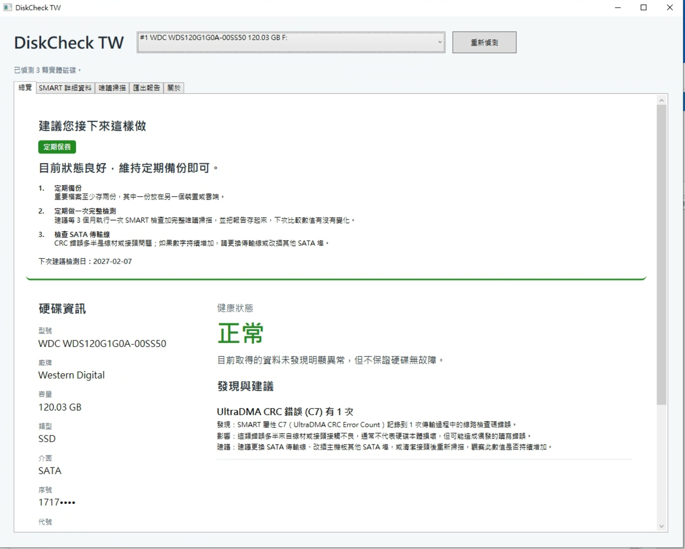
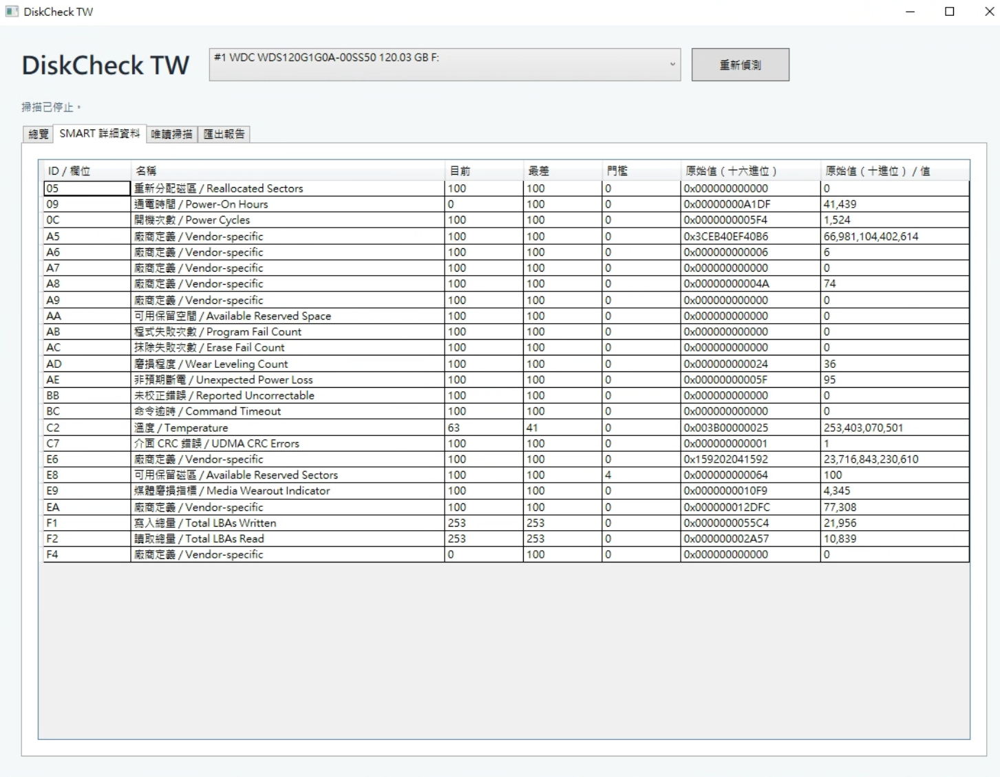
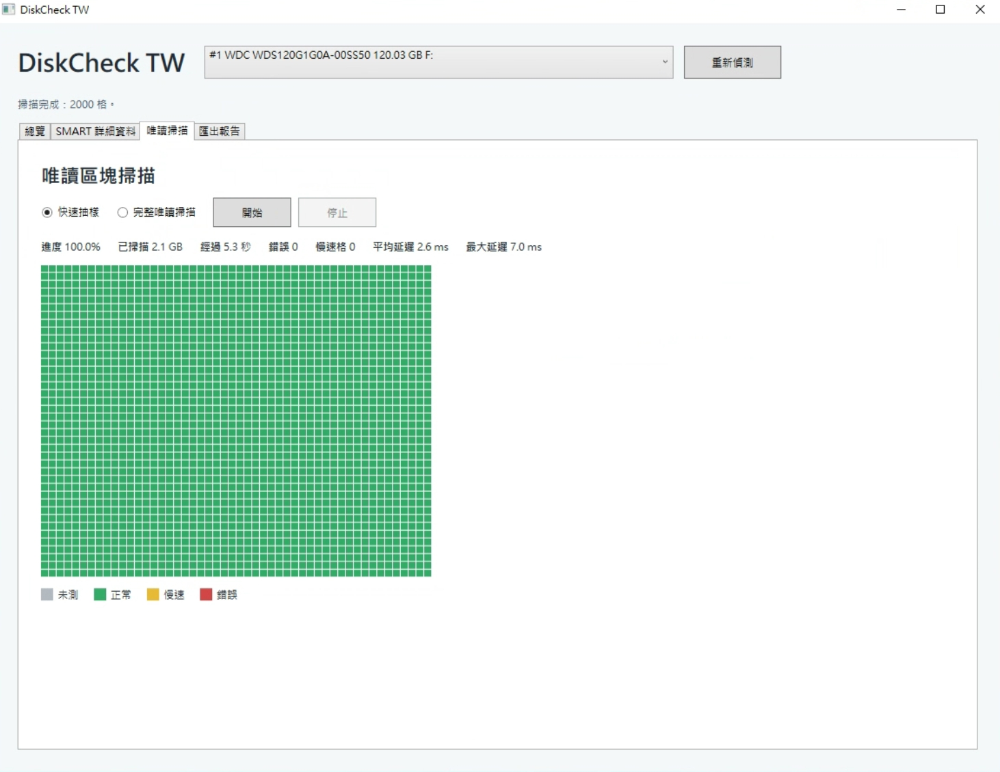

# DiskCheck TW

A free, open-source Windows tool that reads drive SMART data and runs read-only surface scans, so you can tell whether a disk is healthy before it fails.

English | [繁體中文](README.zh-TW.md)

Current version: 0.1.3 · MIT licensed.

## Features

- **Physical disk list** — model, vendor, capacity, media type (HDD / SATA SSD / NVMe), interface, drive letters, temperature, power-on hours and power cycle count.
- **SMART details** — the full ATA SMART attribute table and the NVMe health log (Log 02h). Attribute names are resolved per vendor using data from CrystalDiskInfo (MIT). SSD remaining life is calculated and shown only when the underlying value is trustworthy.
- **Health status** — Good, Caution, Danger or Insufficient data, each with a plain-language explanation instead of raw codes.
- **"What to do next"** — concrete actions grouped as Act now, Act soon, Routine care or Check connection first: back up first, prepare a replacement disk, run a full check every 3 months, and the date of the next recommended check.
- **Read-only block scan** — quick sampling or full scan, with a colored block grid (green OK, yellow slow, red error, gray untested), latency statistics, and a stop button that works at any time.
- **Offline HTML report** — one click, saved wherever you choose; serial numbers are masked by default.
- **Scheduled checks** — monthly, every 3 months or every 6 months through Windows Task Scheduler (installer build only). If a run is missed, the app asks at the next sign-in; scheduled runs are skipped while on battery.
- **Two languages** — Traditional Chinese and English, auto-selected from the Windows display language and switchable by hand.

## Screenshots

Screenshots are from the Traditional Chinese interface; English is selected automatically on non-Chinese Windows. More captures are kept in `docs/images/`.

**Overview with "What to do next"**



**SMART details with vendor-specific attribute names**



**Read-only block scan**



## Download

Downloads are listed on the official site: <https://keelungit.com/diskcheck-tw/>, and in [GitHub Releases](../../releases).

Both packages are self-contained, so no separate .NET installation is required:

- **Installer** — `setup.exe`, shipped inside a zip; adds scheduled checks.
- **Portable** — a zip you can unpack and run.

## Requirements

- Windows 10 or 11, x64.
- Run as **administrator**. Reading physical disks and SMART data requires elevated privileges; without them the app cannot see your drives.

## Safety

Scans are read-only by design:

- Disks are opened with `CreateFile` requesting `GENERIC_READ` (plus `FILE_FLAG_NO_BUFFERING` for the scan). `WriteFile` is never called.
- Volumes are never locked, never dismounted, and bad sectors are never repaired or remapped.
- Windows requires a read/write handle to query SMART. The app therefore holds that handle but only sends an allow-list of read-only commands: ATA `SMART READ DATA` (D0h), `READ THRESHOLDS` (D1h) and `RETURN STATUS` (DAh), plus NVMe `Get Log Page` 02h. No self-test, no enable/disable, no write command of any kind.
- Scanning adds load to a disk that may already be failing, so a warning is shown before a scan starts.

## Privacy

The app makes no network connections, uploads nothing, and contains no telemetry. Reports are written only to the location you pick yourself.

## Limitations

- Some USB enclosures and RAID controllers do not pass SMART data through. In that case the disk is reported as **Insufficient data**, never as Good.
- Healthy SMART values do not guarantee a disk is free of faults.
- Unsigned builds make Windows SmartScreen show an "unknown publisher" warning: choose **More info** → **Run anyway**.
- Scheduled checks are available in the installer build only.

## Build

Requires the .NET 10 SDK.

```sh
dotnet build -c Release
dotnet test tests/DiskCheckTW.Tests
```

`build/publish.sh` produces the self-contained win-x64 portable zip, and also an installer when NSIS 3 is installed. Cross-compiling on Linux works through `EnableWindowsTargeting`, but the hardware features must be tested on Windows.

## Project structure

- `src/DiskCheckTW.Core` — diagnostics, recommendations, reporting and scheduling rules; pure logic, testable cross-platform.
- `src/DiskCheckTW.App` — WPF user interface and Win32 hardware access.
- `tests/DiskCheckTW.Tests` — xUnit tests.
- `build/` — packaging scripts and NSIS definitions.

## License

MIT. See [LICENSE](LICENSE). Third-party terms are listed in [THIRD_PARTY_NOTICES.md](THIRD_PARTY_NOTICES.md), including CrystalDiskInfo (MIT), whose SMART attribute data is used to name vendor-specific attributes, and .NET.
