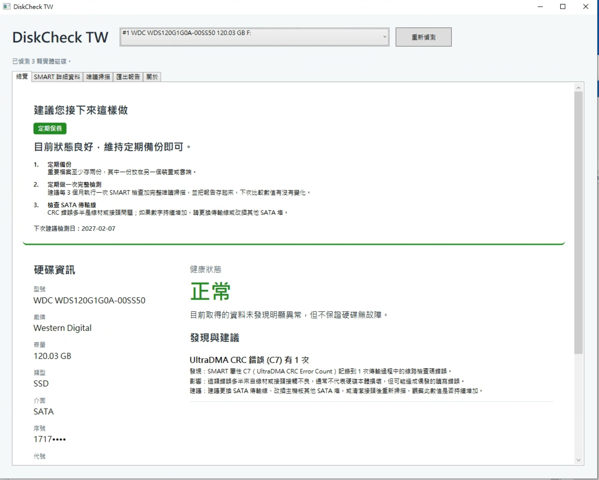
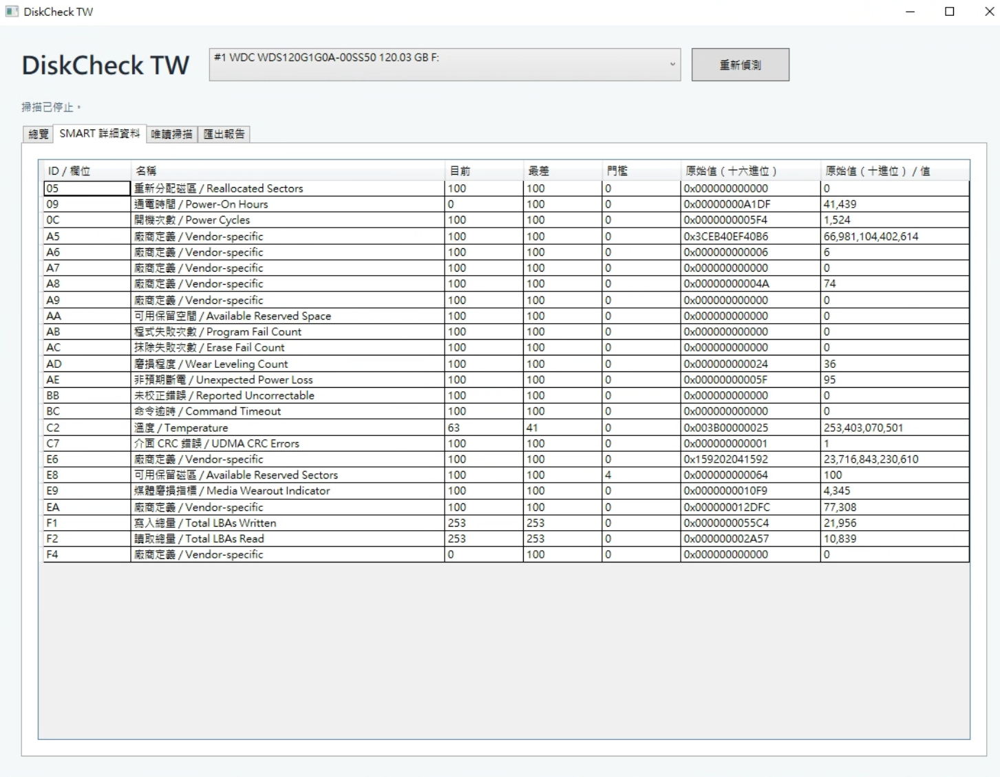
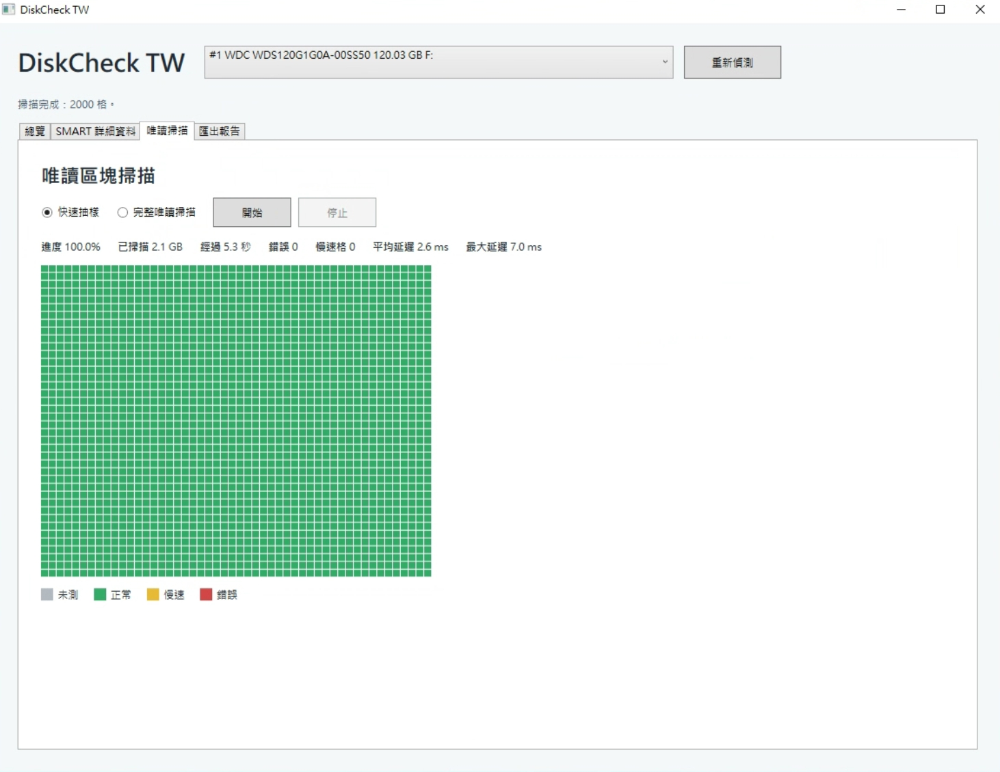

# DiskCheck TW

一款免費、開放原始碼的 Windows 工具，可讀取硬碟的 SMART 資料並執行唯讀的表面掃描，讓你在硬碟故障之前就先判斷它是否健康。

[English](README.md) | 繁體中文

目前版本：0.1.3 · MIT 授權。

## 功能

- **實體硬碟清單** — 型號、廠牌、容量、媒體類型（HDD / SATA SSD / NVMe）、介面、磁碟機代號、溫度、通電時間與開機次數。
- **SMART 詳細資料** — 完整的 ATA SMART 屬性表與 NVMe 健康狀態記錄（Log 02h）。屬性名稱依各廠商分別解析，資料來自 CrystalDiskInfo（MIT）。SSD 剩餘壽命會計算後顯示，且僅在底層數值可信時才顯示。
- **健康狀態** — 正常、注意、危險或資料不足，每種狀態都搭配白話說明，而不是只顯示原始代碼。
- **「建議您接下來這樣做」** — 具體的行動建議，分為立即處理、近期處理、定期保養或先確認連接方式：先備份、準備更換硬碟、每 3 個月做一次完整檢測，並顯示下次建議檢測日。
- **唯讀區塊掃描** — 快速抽樣或完整掃描，搭配彩色區塊方格（綠色正常、黃色緩慢、紅色錯誤、灰色未測試）、延遲統計，以及隨時都能使用的停止按鈕。
- **離線 HTML 報告** — 一鍵產生，存到你指定的位置；序號預設予以遮罩。
- **排程檢測** — 透過 Windows 工作排程器執行每月、每 3 個月或每 6 個月的自動檢測（僅限安裝版）。若錯過執行，程式會在下次登入時詢問；使用電池電力時會跳過排程執行。
- **雙語介面** — 繁體中文與英文，依 Windows 顯示語言自動選擇，也可手動切換。

## 截圖

更多截圖放在 `docs/images/`。

**總覽與「建議您接下來這樣做」**



**SMART 詳細資料（依廠牌顯示屬性名稱）**



**唯讀區塊掃描**



## 下載

下載連結列在官方網站：<https://keelungit.com/diskcheck-tw/>，以及 [GitHub Releases](../../releases)。

兩種版本都已內含 .NET 執行環境，不需要另外安裝 .NET：

- **安裝版** — `setup.exe`，包在 zip 裡；支援排程檢測。
- **免安裝版** — 解壓縮即可執行的 zip。

## 系統需求

- Windows 10 或 11，x64。
- 以**系統管理員**身分執行。讀取實體硬碟與 SMART 資料需要系統管理員權限；沒有權限時，程式無法看到你的硬碟。

## 安全設計

掃描在設計上就是唯讀：

- 開啟硬碟時使用 `CreateFile` 並要求 `GENERIC_READ`（掃描時另加 `FILE_FLAG_NO_BUFFERING`）。絕不會呼叫 `WriteFile`。
- 絕不會鎖定磁碟區、絕不會卸載磁碟區，也絕不會修復或重新對應壞軌。
- Windows 查詢 SMART 需要讀寫權限。因此程式會持有該權限，但只傳送一份唯讀指令的白名單：ATA 的 `SMART READ DATA`（D0h）、`READ THRESHOLDS`（D1h）與 `RETURN STATUS`（DAh），以及 NVMe 的 `Get Log Page` 02h。不做自我測試、不做啟用／停用，也不做任何種類的寫入指令。
- 掃描會對可能已經故障的硬碟增加負載，因此掃描開始前會顯示警告。

## 隱私

程式不建立任何網路連線、不上傳任何內容，也不含遙測。報告只寫到你自行選擇的位置。

## 限制

- 部分 USB 外接盒與 RAID 控制卡不會轉傳 SMART 資料。這種情況下硬碟會被回報為**資料不足**，絕不會回報為正常。
- SMART 數值健康，並不代表硬碟一定沒有故障。
- 未簽章的建置會讓 Windows SmartScreen 顯示「不明發行者」警告：選擇**其他資訊** → **仍要執行**。
- 排程檢測僅限安裝版。

## 建置

需要 .NET 10 SDK。

```sh
dotnet build -c Release
dotnet test tests/DiskCheckTW.Tests
```

`build/publish.sh` 會產生已內含 .NET 執行環境的 win-x64 免安裝版 zip，若已安裝 NSIS 3 也會一併產生安裝程式。在 Linux 上可透過 `EnableWindowsTargeting` 交叉編譯，但硬體相關功能必須在 Windows 上測試。

## 專案結構

- `src/DiskCheckTW.Core` — 診斷、建議、報告與排程規則；純邏輯，可跨平台測試。
- `src/DiskCheckTW.App` — WPF 使用者介面與 Win32 硬體存取。
- `tests/DiskCheckTW.Tests` — xUnit 測試。
- `build/` — 打包腳本與 NSIS 定義。

## 程式碼簽章政策（Code signing policy）

Free code signing provided by SignPath.io, certificate by SignPath Foundation（申請中；v0.1.3 以前的版本未簽章）。簽章範圍、建置方式、團隊角色與隱私政策請見 [Code signing policy](CODE_SIGNING_POLICY.md)。安全問題回報請見 [SECURITY.md](SECURITY.md)。

## 授權

MIT。詳見 [LICENSE](LICENSE)。第三方條款列於 [THIRD_PARTY_NOTICES.md](THIRD_PARTY_NOTICES.md)，包含 CrystalDiskInfo（MIT，其 SMART 屬性資料用於命名各廠商專屬屬性）與 .NET。
